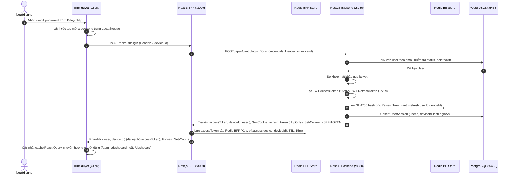
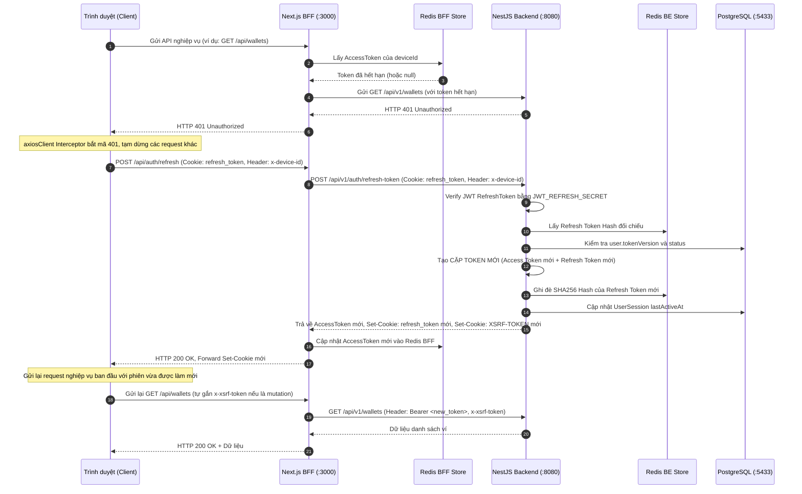

# Kiến Trúc Hệ Thống & Mô Hình BFF (System Architecture & BFF Pattern)

> **Cập nhật lần cuối:** 12/11/2026  
> **Nguồn:** Đọc trực tiếp từ code `frontend/src/lib/bff`, `axio-client.ts`, `server-api-client.ts`, `src/middleware.ts`, `backend/src/main.ts`, không dựa tài liệu cũ.

---

## 1. Tổng Quan Kiến Trúc BFF (Backend-For-Frontend)

BudgetFlow áp dụng mô hình kiến trúc **BFF (Backend-For-Frontend)** với **Next.js 16 App Router**.  
Trình duyệt không gọi trực tiếp API của NestJS Backend mà luôn giao tiếp thông qua Next.js Server Route Handlers (`/api/*`).

### 1.1. Mục Tiêu Thiết Kế
1. **Bảo Mật Tối Đa (Token Isolation):** Access Token không bao giờ được trả về lưu trữ ở `localStorage` hay biến Javascript của trình duyệt nhằm ngăn ngừa triệt để nguy cơ đánh cắp token qua lỗ hổng XSS.
2. **Quản Lý Phiên Tập Trung Phía Server:** Access Token được lưu tại Redis Server BFF theo `deviceId`.
3. **Ẩn Địa Chỉ Hạ Tầng:** URL của backend (`http://localhost:8080/api/v1`) được giữ kín ở phía server, client chỉ biết endpoint `/api/*` trên cùng domain (`http://localhost:3000`).
4. **Tối Ưu Hóa Dữ Liệu:** BFF có khả năng lọc bỏ các trường nhạy cảm trước khi trả về cho UI.
5. **Bảo Vệ CSRF Toàn Tuyến (End-to-End CSRF):** Tự động đồng bộ cookie `XSRF-TOKEN` và header `x-xsrf-token` từ Browser -> BFF -> Backend cho mọi tác vụ thay đổi dữ liệu.

---

## 2. Sơ Đồ Kiến Trúc Thành Phần (Component Architecture)

```text
+-----------------------------------------------------------------------------------+
|                              TRÌNH DUYỆT (BROWSER)                                |
|  - Next.js Client Components (React 19)                                           |
|  - LocalStorage: { 'x-device-id': 'uuid-v4' }                                     |
|  - Cookies: 'refresh_token' (HttpOnly), 'XSRF-TOKEN' (readable)                   |
|  - axiosClient: baseURL='/api', tự động gắn 'x-device-id' & 'x-xsrf-token'        |
+----------------------------------------+------------------------------------------+
                                         |
                                         | 1. HTTP Same-Origin Request (/api/*)
                                         |    Headers: x-device-id, x-xsrf-token
                                         |    Cookies: refresh_token, XSRF-TOKEN
                                         v
+-----------------------------------------------------------------------------------+
|                         NEXT.JS 16 SERVER (BFF LAYER :3000)                       |
|                                                                                   |
|  ┌─────────────────────────────────┐   ┌───────────────────────────────────────┐  |
|  │      App Router Route Handlers  │   │          serverApiClient              │  |
|  │  - /api/auth/login, refresh...  │   │  - Đọc x-device-id từ header request  │  |
|  │  - /api/auth/verify-email       │   │  - Truy xuất AccessToken từ Redis BFF │  |
|  │  - /api/auth/social-session     │   │  - Gắn header Authorization: Bearer   │  |
|  │  - /api/admin/users (Read-only) │   │  - Forward x-xsrf-token & cookies     │  |
|  │  - /api/users/me                │   │  - Chuẩn hóa lỗi qua ApiError         │  |
|  └─────────────────────────────────┘   └───────────────────+───────────────────┘  |
+----------------------+-------------------------------------+----------------------+
                       |                                     |
    Tra cứu Session    | Key: bff:access:device:{id}         | 2. HTTP Forward (/api/v1/*)
    (Token, Role, TTL) |                                     |    Authorization: Bearer <token>
                       v                                     |    x-device-id, x-xsrf-token
        +------------------------------+                     |    Cookies: refresh_token, XSRF-TOKEN
        |        REDIS INSTANCE        |                     v
        |  - BFF Access Sessions       |   +----------------------------------------+
        |  - BE Refresh Token Hashes   |   |         NESTJS BACKEND (:8080)         |
        |  - Rate Limiting Counters    |   |  - Core Security:                      |
        |  - BullMQ Queues (Emails)    |   |    Helmet, CsrfGuard, JwtAuthGuard,    |
        +------------------------------+   |    PoliciesGuard (CASL)                |
                       ^                   |  - Controllers & Business Services     |
                       |                   +-------------------+--------------------+
                       | Lấy Refresh Hash                      |
                       | Gửi Job Mail                          | Prisma ORM 7
                       +---------------------------------------+
                                                               v
                                           +----------------------------------------+
                                           |         POSTGRESQL 16 (:5433)          |
                                           |  - Users, Wallets, Transactions...     |
                                           +----------------------------------------+
```

---

## 3. Sequence Diagram: Luồng Đăng Nhập (Login Flow)



---

## 4. Sequence Diagram: Luồng Tự Động Cấp Lại Token (Token Refresh Flow)



---

## 5. Ranh Giới Trách Nhiệm (Separation of Concerns)

| Tầng | Trách nhiệm chính | Điều cấm / Không thực hiện |
|---|---|---|
| **Trình duyệt (Browser)** | Hiển thị UI, thu nhận tương tác, lưu `x-device-id`, gửi cookie qua request same-origin, tự động gắn `x-xsrf-token`. | Không lưu trữ hay xử lý trực tiếp JWT Access Token. Không gọi trực tiếp backend port 8080. |
| **Next.js BFF Server** | Route trung gian `/api/*`, ánh xạ session từ `deviceId` ra `accessToken`, forward cookie và `x-xsrf-token`, bắt lỗi HTTP. | Không lưu mật khẩu hoặc thực thi logic nghiệp vụ phức tạp của database. |
| **NestJS Backend** | Xử lý toàn bộ logic nghiệp vụ, xác thực mật khẩu, kiểm soát quyền truy cập CASL, kiểm tra CSRF song song, ghi log kiểm toán, quản lý giao dịch DB. | Không phụ thuộc vào trạng thái session của UI. |
| **Redis** | Lưu trữ phân tán: hash refresh token (BE), access token session (BFF), rate limit, queue gửi mail. | Không dùng làm nơi lưu dữ liệu lâu dài thay thế PostgreSQL. |
| **PostgreSQL** | Cơ sở dữ liệu quan hệ chính, bảo đảm tính toàn vẹn dữ liệu tài chính (ACID). | |

---

## 6. Điểm Cần Lưu Ý / Khuyến Nghị Triển Khai

1. **Kết nối Redis trong Môi Trường Triển Khai Docker:**
   - Khi chạy cả Backend và Frontend trong Docker Compose, biến `REDIS_HOST` ở cả hai bên phải đặt là `redis` (tên service trong mạng Docker) thay vì `localhost`.
2. **CSRF Protection Đã Tích Hợp Đầy Đủ:**
   - Client và BFF hiện đã tự động đồng bộ cookie `XSRF-TOKEN` và header `x-xsrf-token`, loại bỏ hoàn toàn nguy cơ bị `CsrfGuard` của backend chặn với mã HTTP 403 Forbidden.
3. **Next.js Edge Middleware (`src/middleware.ts`):**
   - Đã được chuẩn hóa từ `src/proxy.ts`, bảo vệ an toàn toàn bộ các route trang ngoài whitelist trước khi render giao diện.
