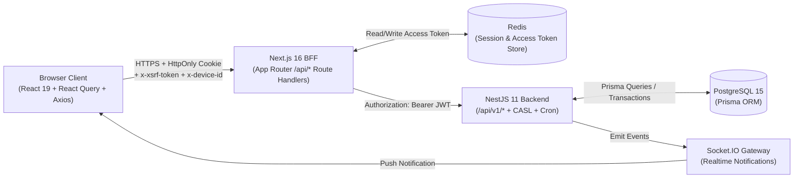
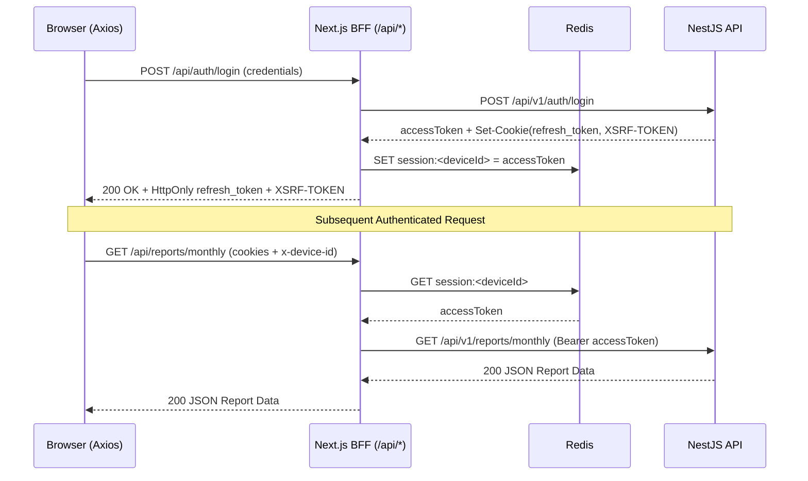

# System Architecture

BudgetFlow is structured around a **Backend-for-Frontend (BFF)** architecture that decouples the browser client from the core NestJS API, ensuring strong token isolation, CSRF protection, and real-time event delivery.

---

## 1. Overall Data Flow

---

## 2. Authentication & Security Flow

BudgetFlow eliminates the risk of XSS token theft by **never storing JWT Access Tokens in `localStorage` or browser-accessible cookies**.

### Key Mechanisms
1. **Server-Side Token Storage (Redis):**
   - Upon login (`/api/auth/login`), the NestJS backend returns an `accessToken`, sets an `HttpOnly` `refresh_token` cookie, and issues an `XSRF-TOKEN` cookie.
   - The Next.js BFF stores the `accessToken` in **Redis** keyed by the user/device session, keeping it strictly server-side.
2. **CSRF Double Submit Cookie:**
   - For mutating requests (`POST`, `PUT`, `PATCH`, `DELETE`), the browser Axios request interceptor (`src/lib/axios/axio-client.ts`) reads the `XSRF-TOKEN` cookie and attaches it to the `x-xsrf-token` header.
   - Every client request also includes a persistent `x-device-id` header and `device_id` cookie for multi-device session tracking (`UserSession`).
3. **Silent Refresh & Loop Prevention:**
   - When an authenticated request receives `401 Unauthorized`, the Axios response interceptor queues a single `POST /api/auth/refresh` call (`refreshPromise` deduplication) and retries the original request once (`_retry = true`).
   - Public routes (`/`, `/login`, `/register`, `/forgot-password`, `/reset-password`) and unauthenticated `/users/me` or `/users/preferences` checks bypass refresh-token loops.
   - On logout (`useLogout`), React Query cancels and purges in-flight polling queries (such as `NotificationBell`) *before* invalidating tokens.

---

## 3. Realtime & Scheduled Automation

### WebSocket Push (`NotificationGateway`)
- The NestJS `NotificationModule` exposes a Socket.IO gateway that pushes events (e.g., `transaction:completed`, budget warnings, recurring execution alerts) directly to connected user rooms.
- On the frontend, `NotificationBell` polls `/api/notifications` only when `isAuthenticated === true` and merges real-time updates seamlessly.

### Cron Job Automation (`RecurringCronService`)
- `RecurringCronService` runs on a `@Cron(CronExpression.EVERY_MINUTE)` schedule using `@nestjs/schedule`.
- It queries active, non-deleted `RecurringTransaction` rules where `nextRunDate <= nowUtc` (strictly compared in UTC).
- Inside an atomic `prisma.$transaction`, each due rule:
  1. Creates a new `Transaction` record.
  2. Increments or decrements the target `Wallet.balance`.
  3. Updates `lastRunDate`, computes the next `nextRunDate` via `addInterval()`, and deactivates the rule if `nextRunDate > endDate`.
  4. Persists a `Notification` record and emits a Socket.IO event to the user.

### React Query Cache Synchronization
- All frontend mutation hooks (`useCreateTransaction`, `useCreateGoal`, `usePayDebt`, `useCreateBudget`, `useCreateWallet`, `useCreateRecurringTransaction`, etc.) invoke `invalidateDashboardQueries(queryClient)` in `onSuccess` to keep Dashboard StatCards, Wallets, Budgets, Goals, Debts, and Reports immediately synchronized without a page reload.
