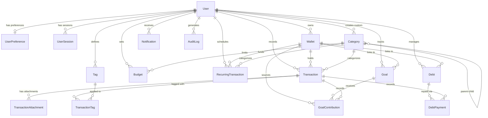

# Database Schema & ERD

BudgetFlow uses **PostgreSQL 15** managed via **Prisma ORM** (`backend/prisma/schema.prisma`). All core entities support UUID primary keys, `Timestamptz` UTC timestamps, soft deletion (`deletedAt`) where appropriate, and bilingual naming (`nameVi`, `nameEn`) on `Category` and `Wallet`.

---

## Entity Relationship Diagram (ERD)

---

## Core Tables & Relationships

### 1. Identity, Preferences & Security

| Model | Relationship | Description |
| :--- | :--- | :--- |
| **`User`** | Root entity (`1-1`, `1-N`) | Stores user credentials, role (`USER` \| `ADMIN`), status, and OAuth provider metadata. |
| **`UserPreference`** | `1-1` with `User` | Stores persisted UI settings including `language` (`VI` \| `EN`), default currency, and notification toggles. |
| **`UserSession`** | `1-N` from `User` | Tracks active multi-device sessions (`deviceId`, refresh token hash, IP, user agent). |
| **`AuditLog`** | `1-N` from `User` | Immutable security & administrative audit trail. |

### 2. Wallets, Categories & Transactions

| Model | Relationship | Description |
| :--- | :--- | :--- |
| **`Wallet`** | `1-N` from `User` | Financial accounts (`CASH`, `BANK`, `E_WALLET`, `CREDIT_CARD`, `INVESTMENT`) with `balance`, `currency`, `nameVi`, and optional `nameEn`. |
| **`Category`** | `1-N` from `User` (nullable for system defaults) & self-referencing `1-N` | Income/Expense categories with bilingual `nameVi`, `nameEn`, `icon`, `color`, and optional parent category hierarchy. |
| **`Transaction`** | `1-N` from `User`, `Wallet`, `Category` | Core ledger entries (`INCOME`, `EXPENSE`, `TRANSFER`) with `amount`, `date` (UTC), `status`, `walletId`, plus `fromWalletId`/`toWalletId` for transfers. |
| **`Tag` & `TransactionTag`** | `N-N` between `Transaction` and `Tag` | Flexible user-defined labels joined via `TransactionTag`. |
| **`TransactionAttachment`** | `1-N` from `Transaction` | Receipt/document attachments linked to transactions. |

### 3. Planning, Automation & Analytics

| Model | Relationship | Description |
| :--- | :--- | :--- |
| **`Budget`** | `1-N` from `User`, `Category` | Spending limits per category/period with alert thresholds. |
| **`RecurringTransaction`** | `1-N` from `User`, `Wallet`, `Category` | Automated rules (`DAILY`, `WEEKLY`, `MONTHLY`, `YEARLY`) with `interval`, `startDate`, `endDate`, `lastRunDate`, `nextRunDate`, and `isActive`. Processed by `RecurringCronService`. |
| **`Goal` & `GoalContribution`** | `1-N` from `User` -> `Goal` -> `GoalContribution` | Savings targets with progress tracking; each contribution can link to a `Wallet` and generate a `Transaction`. |
| **`Debt` & `DebtPayment`** | `1-N` from `User` -> `Debt` -> `DebtPayment` | Tracks both liabilities (`LOAN` — money borrowed) and receivables (`DEBT` — money lent), along with individual payments linked to `Transaction`. |
| **`Notification`** | `1-N` from `User` | In-app notifications (`BUDGET`, `GOAL`, `DEBT`, `RECURRING`, `SYSTEM`) pushed via Socket.IO and polled by `NotificationBell`. |
